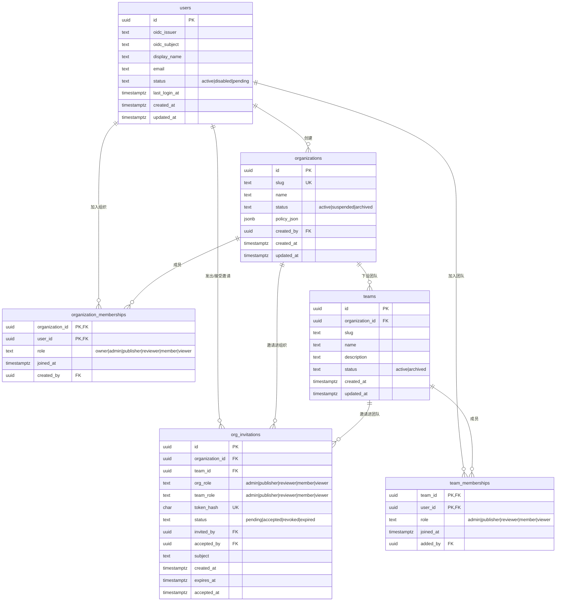
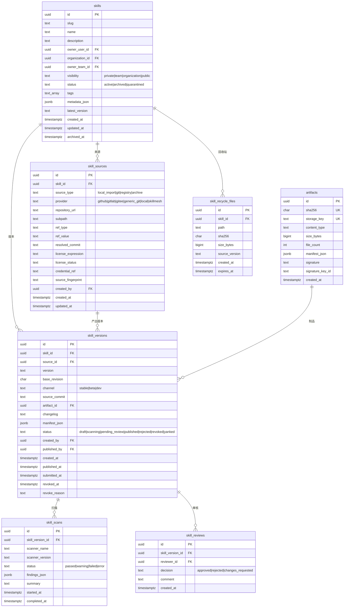
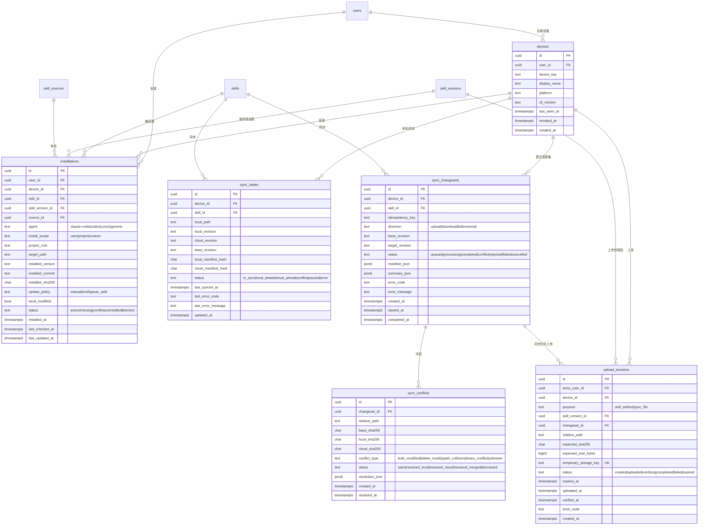
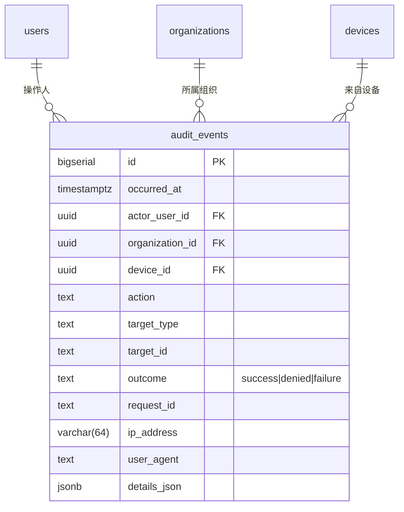
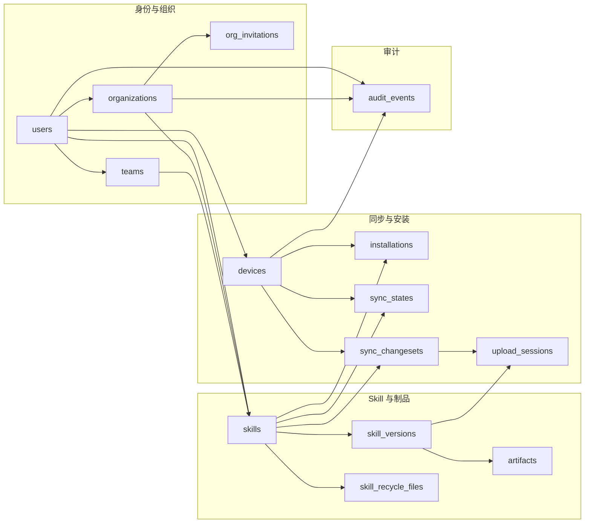

# 数据库 ER 图

SkillMesh 的数据库是 PostgreSQL 18，20 张表。表结构只有一份权威定义 —— Flyway 迁移
[`apps/api/src/main/resources/db/migrations/V1__init.sql`](../apps/api/src/main/resources/db/migrations/V1__init.sql)；
本文是它的图形化视图，**改了迁移脚本就得同步改这里**。

图按域拆成四张，避免一张图糊成一团。域之间靠 `skill_id` / `skill_version_id` / `device_id`
这几个外键接起来。

## 一、身份与组织

谁在用、属于哪些组织与团队。

要点：

- `users` 按 `(oidc_issuer, oidc_subject)` 唯一 —— 同一个人在两个 IdP 下是两个账号。
- `organization_memberships` / `team_memberships` 是复合主键的多对多连接表。
- `org_invitations.org_role` **不含 `owner`**：owner 只能由现任 owner 直接任命，邀请给不了。

## 二、Skill 与制品

Skill 本体、来源、版本、制品与审核。

要点：

- **`skill_versions` 是不可变载体**：`artifact_id`、`version`、`source_commit`、`manifest_json` 发布后不改；
  撤回靠 `status='revoked'` + `revoked_at`，改内容靠发新版本。
- `skills.latest_version` 与 `skill_versions (skill_id, version)` 之间有一条**延迟检查的外键**
  （`fk_skills_latest_version`，`DEFERRABLE INITIALLY DEFERRED`）：发版事务里先写版本行、
  后更新 `latest_version`，靠延迟到事务提交时才校验。
- **没有单独的权限表**：谁能看、谁能装、谁能发，由 Skill 的归属与 `visibility`，
  加上 `organization_memberships` / `team_memberships` 里的角色推导出来。
- `skill_recycle_files` 只存元数据：文件内容还在旧版本的制品里，恢复时从那里取字节重打一版。

## 三、设备、安装与同步

客户端在本机装了什么、以及云端与本机的对账。

要点：

- `sync_states` 一行 = 一个设备上一个 Skill 的一个本地路径（三列复合唯一），存**本地与云端两份修订号**
  和两份清单哈希，`status` 就是对账结论。
- `sync_changesets.idempotency_key` + `device_id` 唯一：同一台设备重复提交同一次变更只会有一行。
- `upload_sessions` 分两种用途（`purpose`）：`skill_artifact` 指向 `skill_version_id`，
  `sync_file` 指向 `changeset_id` + `relative_path` —— 这条互斥关系由 CHECK 约束保证。
- 上传走「先写临时对象 → 校验哈希 → 落库 → 异步清孤儿」，所以对象存储里会有短期孤儿，
  由 [清理桶里的孤儿对象](部署与排障.md#清理桶里的孤儿对象) 一节收尾。

## 四、审计

谁在什么时候对什么做了什么。

要点：

- `target_type` + `target_id` 是多态引用，指向任意业务对象，**没有外键**（审计表不能因为业务对象被删就跟着删）。
- `actor_user_id` / `organization_id` / `device_id` 都是 `ON DELETE SET NULL` —— 人或设备注销了，审计流水还在。

## 关系总览

## 维护

改 schema 时同步更新本文的两处：

1. 上面的 Mermaid 图（表、列、外键）
2. [详细设计 §1.3](详细设计.md#13-ddl-落地说明) 里与该表相关的落地约束

字段类型与约束的权威来源始终是 `V1__init.sql`；本图只保证「关系与关键约束」与之一致。
